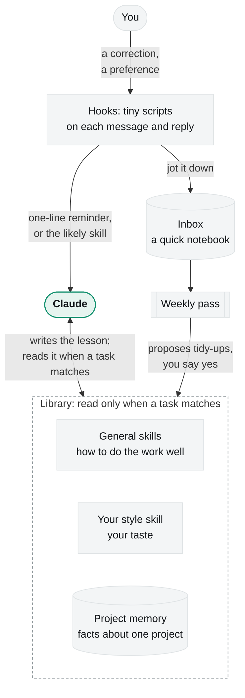

# claude-code-learns

**Correct it once. It remembers.**

Claude Code starts every session fresh, so a correction you made on Monday can be needed again on Friday. This repo
gives it a simple learning loop. When you correct it, it writes the lesson down as one short line in the right file, and
the next session reads that file when the task calls for it. Once a week a tidy-up pass keeps the files small. It is
built only from parts Claude Code already has: skills, hooks, memory and scheduled tasks.

**Install:** [one command](#install) &emsp; **Undo:** [one command](#undo) &emsp;
**Explainer page:** [kat-titter.github.io/claude-code-learns](https://kat-titter.github.io/claude-code-learns/)

## What it looks like

**A correction becomes a habit.**

> **You:** no, the legend covers the data. legends go outside the plot.
>
> **Claude:** Moved the legend below the chart. *Skill updated: figure-design, legend outside the plot.*

Two weeks later, in a new session, you ask for a different chart. The legend is outside the plot, and nobody had to say
so. The lesson went in as one line: what to do, an example, the date.

**Taste goes to your own file, not everyone's.**

> **You:** please no dots between words in the footer, I find them fussy.

That's a preference, not a rule of good design, so it goes to your personal style skill (`yourname-style`). Your general
skills stay usable by anyone, and your taste lives in one place.

**A project fact goes to that project's memory.**

> **You:** the staging server is on port 8080, not 3000.

That's true for one project only, so it becomes a memory note for that project and never clutters a skill.

**It catches what slipped by.**

You mention "why is this taking so long?" halfway through a busy task, and Claude, busy, says nothing about it. After
the reply, a hook jots the line into a notebook (`lessons-inbox.md`). On its own it stays there. If it comes up again
next week, the weekly pass suggests a lesson for it.

**It points at the right skill.**

> **You:** the transition between the two tracks is rough, the kicks flam

Skills often go unused even when they fit: in one person's real sessions, a skill that clearly matched the request
loaded on its own only about 1 time in 5. So a hook notices that the request shares rare words (*transition, track,
flam*) with one skill's description and adds a single line naming it. Claude then loads it before starting.

**Monday morning, a short report.**

The weekly pass leaves a page like this, and changes nothing until you say yes:

```
Upstream     1 new skill (pdf-forms): overlaps nothing you have
Gaps         2 notes in the inbox that no skill covers, e.g. "the numbers don't match the sources"
Misses       github-practice loaded for 3 of 9 requests that matched it: add "pages, publish" to its description?
Health       one skill is 540 lines: split by task
Proposed     at most five changes, most useful first
```

## Four words you'll need

| word | in plain terms |
|---|---|
| **Claude Code** | an AI assistant that works in your terminal or desktop app, reading and editing files with you |
| **skill** | a short how-to file. Each session sees only its one-paragraph description, like a label on a shelf; the full text is read only when a task matches |
| **hook** | a tiny script Claude Code runs at a set moment, such as when you send a message or after each reply. Here hooks only add a line of context or write a log; they never block you |
| **memory and `CLAUDE.md`** | notes Claude Code keeps about you and each project (a short index is read every session), and a short file of standing instructions read at the start of every session |

## How it works



1. **Notice.** Hooks spot feedback ("no", "from now on", "too much text") and add a one-line reminder to route it.
2. **Generalize.** Claude asks what family of problems the correction belongs to, and writes for the whole family.
3. **Route.** How anyone should do the work goes to a general skill; your taste to your style skill; a fact about one
   project to that project's memory.
4. **Write the gist.** One line: what to do, an example, the date. A second case folds into the same line.
5. **Check it loads.** A lesson that never loads might as well not exist, so the setup tests that skills load when
   they should, both in tests and in real sessions.
6. **Tidy weekly.** A scheduled pass reads the notebook, the miss report and the library's health, and proposes at
   most five changes.

The detail lives in [`skills/capture-lesson/SKILL.md`](skills/capture-lesson/SKILL.md).

<details>
<summary><b>How it borrows from human memory</b></summary>

The design copies a few well-tested ideas about how people learn. The plain idea comes first, then the scientific term
in brackets for anyone who wants to look it up. It's an analogy, not a claim that the software works like a brain.

| how people learn | what this setup does |
|---|---|
| We learn fast in a quick notebook and slowly in a tidy library; the slow store builds general knowledge from many cases (complementary learning systems[^1][^2]) | the inbox catches moments cheaply; skills hold the general lesson, written for the whole family of cases |
| Surprise teaches: learning follows the gap between what we expected and what happened (prediction error[^3]) | a correction is that gap, so the feedback hook fires on corrections and surprise, not on every message |
| Sleep replays the day and sorts what to keep (replay and consolidation[^4][^5]) | the weekly pass re-reads the notebook while you're away and proposes what to keep |
| Something new that fits what you already know is learned in one go (schemas[^6]) | a new case folds into the section that already owns it, instead of starting a new file |
| We find a memory through the same cues it was stored with (encoding specificity[^7]) | skill descriptions use the words people actually say when they need them; the router matches those words |
| Testing yourself beats rereading (testing effect[^8]) | trigger tests and the miss report check that each skill loads when it should, instead of rereading it |
| Spread-out repeats stick better than one cram (spacing[^9]) | a note that comes back in a later session is promoted; one that never returns stays in the notebook |
| Forgetting is useful: it drops stale detail and keeps the system lean (adaptive forgetting[^10][^11]) | the weekly pass merges, compresses and archives |
| We hold only about four things in mind at once (working memory[^12]) | the always-loaded layer stays a few lines; everything else waits on disk until a task needs it |

Claude Code's own memory is the project shelf of this design. Its auto memory keeps one fact per note with a one-line
index, and this setup sends project facts there. Taste and craft go to skills, which every project can use.

</details>

<details>
<summary><b>What keeps it light on tokens</b></summary>

Every word Claude reads costs attention and money (a "token" is about three quarters of a word), so the loop is built
to read little:

| | when it is read | size |
|---|---|---|
| skill descriptions (3 on a fresh install) | every session | about 370 tokens in all |
| the routing section of `CLAUDE.md` | every session | about 130 tokens |
| feedback reminder | only on a message that reads like feedback (about 1 in 7) | about 100 tokens |
| skill-router line | only when a request strongly matches a skill (about 1 in 16) | about 30 tokens |
| prompt reminder | on a message that starts in lowercase or has no closing punctuation: most messages if you dictate (84% for one person who does) | about 55 tokens |
| skill bodies | only when a task matches, once per session | 0 until then |
| inbox, usage log, weekly reports | never in a session: scripts read them and hand over a short summary | 0 |

What keeps it that way:
- **Scripts read, the model judges.** The audit, the watch and the miss report scan every file in well under a second
  and pass Claude a short list of what changed. Claude opens only the files the list names.
- **Quiet by default.** Each hook was measured on about 230 real prompts before shipping, and most prompts add nothing.
- **One line per lesson.** A second case folds into the line that's already there, so skills grow slowly.
- **Incremental.** The weekly pass remembers what it saw and reports only what changed.
- **Layers.** Claude Code lists each skill's name and description every session (cut at 1,536 characters each, and
  the least-used drop first when the list passes 1% of the context window). A skill's full text loads only when used.

</details>

<details>
<summary><b>Built on current practice, and what it adds</b></summary>

| practice (source) | what Claude Code gives you | what this setup adds |
|---|---|---|
| Rules that must hold every time go in hooks; skills and `CLAUDE.md` are guidance ([Claude Code best practices](https://code.claude.com/docs/en/best-practices)) | hooks, skills, `CLAUDE.md` | hooks that only remind and log, never block; the lesson itself stays guidance Claude can weigh |
| Context is a finite budget: load the smallest set of high-signal tokens ([Effective context engineering](https://www.anthropic.com/engineering/effective-context-engineering-for-ai-agents)) | a skill listing and on-demand bodies | hooks that stay silent on most prompts, with fire rates measured on real prompts |
| Progressive disclosure: descriptions always, bodies on demand ([Agent Skills](https://code.claude.com/docs/en/skills)) | the skill listing | one line per lesson, an audit that flags long or overlapping skills, `references/` for long tails |
| Keep memory outside the context window ([memory docs](https://code.claude.com/docs/en/memory)) | auto memory and `CLAUDE.md` | a routing rule that gives every lesson one home (skill, style skill or project memory), and an inbox that is never loaded |
| Write descriptions as triggers, and test them ([skill best practices](https://platform.claude.com/docs/en/agents-and-tools/agent-skills/best-practices)) | skill-creator's evals | old vs new description at three runs each, a miss report from real sessions, and a router hook that names the likely skill |
| Hooks are fast, quoted and fail-safe, with timeouts ([hooks docs](https://code.claude.com/docs/en/hooks)) | `timeout`, `async` | every hook exits cleanly in about 30 ms; loggers run in the background |
| Outside content is data, not instructions ([Equipping agents with skills](https://www.anthropic.com/engineering/equipping-agents-for-the-real-world-with-agent-skills)) | permission prompts | the weekly pass reads upstream skills and the inbox as quotes to judge, and waits for your yes |
| Cheap rollback ([Effective harnesses for long-running agents](https://www.anthropic.com/engineering/effective-harnesses-for-long-running-agents)) | checkpoints | backups before every change, `--uninstall`, and the skills folder kept in git |

</details>

## Install

You need Claude Code and Python 3. From a terminal:

```bash
git clone https://github.com/kat-titter/claude-code-learns && cd claude-code-learns
```

```bash
./install.sh --name yourname --dry-run
```

```bash
./install.sh --name yourname
```

The dry run shows every change first. The install adds two skills (`capture-lesson`, `prompt-practice`), a
`yourname-style` skill for your taste, a routing section in `CLAUDE.md`, and five small hooks in `settings.json`. It
backs up each file before changing it, and re-running is safe. Start a new session so everything loads. For the weekly
pass, paste `skills/capture-lesson/weekly-watch.md` into a weekly scheduled task. Add `--examples` for four example
skills.

## Undo

```bash
./install.sh --uninstall
```

Removes the hooks, the two skills and the `CLAUDE.md` section, after a backup. Your style skill, notebook and notes stay.
To silence one hook, delete its line under `"hooks"` in `~/.claude/settings.json`.

## What it writes, and where

Everything stays on your machine, in `~/.claude`:
- `lessons-inbox.md`: short quotes of messages that sounded like feedback. Anything you paste can end up quoted there,
  so prune it freely.
- `skill-usage.log`: one line per skill use (time, skill, session id).
- `skills-watch/`: the weekly reports.
- `.skill-index.json`: the router's word list, rebuilt when a skill changes.
- Your skills and memory notes, which you can read and edit like any other file.

## Files

```
install.sh                set up, or undo, in one command
skills/capture-lesson/    the skill that writes skills, its hooks, checks and the weekly prompt
skills/prompt-practice/   turns a short or dictated request into a clear brief, with its hook
skills/html-*/, ...       example general skills, installed with --examples
templates/, *.example*    starting points: style skill, CLAUDE.md, hooks, memory, inbox
coding-skills.md          an example library after a few months of use
index.html                the explainer page
```

Code under the MIT license; see [`LICENSE`](LICENSE).

[^1]: McClelland, McNaughton & O'Reilly (1995). Why there are complementary learning systems in the hippocampus and neocortex. *Psychological Review*. [doi:10.1037/0033-295X.102.3.419](https://doi.org/10.1037/0033-295X.102.3.419)
[^2]: Kumaran, Hassabis & McClelland (2016). What learning systems do intelligent agents need? *Trends in Cognitive Sciences*. [doi:10.1016/j.tics.2016.05.004](https://doi.org/10.1016/j.tics.2016.05.004)
[^3]: Schultz, Dayan & Montague (1997). A neural substrate of prediction and reward. *Science*. [doi:10.1126/science.275.5306.1593](https://doi.org/10.1126/science.275.5306.1593)
[^4]: Wilson & McNaughton (1994). Reactivation of hippocampal ensemble memories during sleep. *Science*. [doi:10.1126/science.8036517](https://doi.org/10.1126/science.8036517)
[^5]: Diekelmann & Born (2010). The memory function of sleep. *Nature Reviews Neuroscience*. [doi:10.1038/nrn2762](https://doi.org/10.1038/nrn2762)
[^6]: Tse et al. (2007). Schemas and memory consolidation. *Science*. [doi:10.1126/science.1135935](https://doi.org/10.1126/science.1135935)
[^7]: Tulving & Thomson (1973). Encoding specificity and retrieval processes in episodic memory. *Psychological Review*. [doi:10.1037/h0020071](https://doi.org/10.1037/h0020071)
[^8]: Roediger & Karpicke (2006). Test-enhanced learning. *Psychological Science*. [doi:10.1111/j.1467-9280.2006.01693.x](https://doi.org/10.1111/j.1467-9280.2006.01693.x)
[^9]: Cepeda et al. (2006). Distributed practice in verbal recall tasks. *Psychological Bulletin*. [doi:10.1037/0033-2909.132.3.354](https://doi.org/10.1037/0033-2909.132.3.354)
[^10]: Richards & Frankland (2017). The persistence and transience of memory. *Neuron*. [doi:10.1016/j.neuron.2017.04.037](https://doi.org/10.1016/j.neuron.2017.04.037)
[^11]: Tononi & Cirelli (2014). Sleep and the price of plasticity. *Neuron*. [doi:10.1016/j.neuron.2013.12.025](https://doi.org/10.1016/j.neuron.2013.12.025)
[^12]: Cowan (2001). The magical number 4 in short-term memory. *Behavioral and Brain Sciences*. [doi:10.1017/S0140525X01003922](https://doi.org/10.1017/S0140525X01003922)
