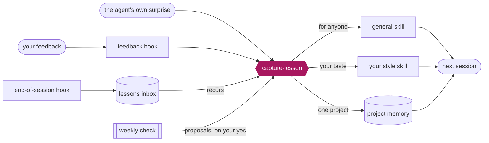

# claude-code-learns

**Correct it once. It remembers.** Feedback becomes a skill, the library keeps itself tidy, and a weekly check finds
new skills worth adding. Built only on what Claude Code already has: skills, hooks, memory and scheduled tasks.

**Explainer:** [kat-titter.github.io/claude-code-learns](https://kat-titter.github.io/claude-code-learns/) &emsp;
**Install:** [one command](#2-install) &emsp; **Example library:** [`coding-skills.md`](coding-skills.md)

---

## 1. How it works



- **Learns fast**: a correction becomes a guideline in the same turn.
- **Notices mistakes**: hooks catch feedback; the agent flags its own surprises.
- **Stays light**: only skill descriptions load each session; the rest waits on disk.

## 2. Install

```bash
git clone https://github.com/kat-titter/claude-code-learns && cd claude-code-learns
```

```bash
./install.sh --name yourname
```

Adds the `capture-lesson` skill, a `yourname-style` skill for your taste, and two hooks. For the weekly check, paste
`skills/capture-lesson/weekly-watch.md` into a weekly scheduled task.

> [!TIP]
> `./install.sh --name yourname --dry-run` shows every change first. Re-running is safe.

## 3. Keeping it tidy

- One home per guideline; a new case extends the line that is already there.
- Each guideline is one line: what to do, an example, the date.
- `audit-skills.py` flags repeats, overlaps and long skills to merge or split.

## 4. Files

```
install.sh              set up in one command
skills/capture-lesson/  the skill that writes skills, with its hooks and checks
templates/, *.example*  starting points: style skill, CLAUDE.md, hooks, memory, inbox
coding-skills.md        an example library of 15 skills
index.html              the explainer
```

## 5. Colophon

Built with Claude Code by Kat Titterton. Code under the MIT license; see [`LICENSE`](LICENSE).
