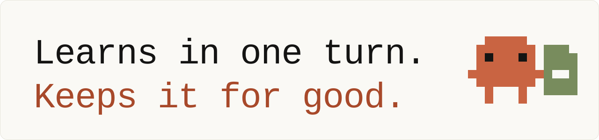

<h1>
<picture>
  <source media="(prefers-color-scheme: dark)" srcset="assets/banner-dark.svg">
  
</picture>
</h1>

[](https://code.claude.com/docs)
[](#install)
[](AGENTS.md#invariants)
[](LICENSE)

Claude Code is a brilliant colleague with no long-term memory. Correct it on Monday and you can be correcting the same
thing on Friday.

This repo closes that gap. When you push back, Claude writes the lesson down as one short line in the right file.
Later sessions read that file when a task calls for it. Once a week a tidy-up pass merges what repeats and drops what
nothing needed, a bit like sleep sorting a day.

None of it is new machinery. It runs on parts Claude Code already has: skills, hooks, memory and scheduled tasks. So
what you install is some text files, a few scripts, and five small hooks that only add a line of context or write a
log.

**Install:** [one command](#install) &emsp; **Undo:** [one command](#undo) &emsp;
**Why it works:** [the explainer page](https://kat-titter.github.io/claude-code-learns/) &emsp;
**For agents:** [`AGENTS.md`](AGENTS.md)

## What it looks like

A correction becomes a habit:

> **You:** no, the legend covers the data. legends go outside the plot.
>
> **Claude:** Moved the legend below the chart. *Skill updated: figure-design, legend outside the plot.*

Two weeks later, in a new session, you ask for a different chart. The legend is outside the plot and nobody had to say
so. One line went in, carrying four things: what to do, an example, the reason, the date. That reason is what lets the
line bend later.

Not every lesson belongs in the same place, so each one is routed:

| you say | goes to | why |
|---|---|---|
| "legends go outside the plot" | a general skill | good practice for anyone |
| "no dots between words, I find them fussy" | your own `yourname-style` | your taste, not everyone's rule |
| "staging is on port 8080, not 3000" | that project's memory | true for one project |

Pushback you make in passing is caught too. Say "why is this taking so long?" halfway through a busy task, and Claude,
busy, may answer nothing. After the reply, though, a hook files the line in `lessons-inbox.md`. There it sits. Say
something like it again next week and the weekly pass proposes a lesson for it.

Skills also go unused when they fit. In one person's real sessions, a skill that plainly matched the request loaded on
its own about 1 time in 5. So a hook reads each request for rare words that match a skill's description, and names the
likely one in a single line. Ask about *references* whose *numbering* has *drifted*, and it names
[`citations`](skills/citations/SKILL.md) before work starts.

<details>
<summary><b>Three words, in plain terms</b></summary>

**skill** — a short how-to file. Each session sees only its one-paragraph description, like a label on a shelf.
The full text is read when a task matches.

**hook** — a tiny script Claude Code runs at a set moment, such as when you send a message. These ones add a line of
context or write a log, and they cannot block you.

**memory and `CLAUDE.md`** — notes Claude Code keeps per project, read through a one-line index, and a short file of
standing instructions read at the start of every session.

Everything above is Markdown, so the memory is files you can open, read and edit.

</details>

## Install

You need Claude Code and Python 3. From a terminal:

```bash
git clone https://github.com/kat-titter/claude-code-learns && cd claude-code-learns
```

```bash
./install.sh --name yourname --dry-run
```

```bash
./install.sh --name yourname
```

The dry run prints every change first and writes nothing. The real run adds two skills (`capture-lesson` and
`prompt-practice`), a `yourname-style` skill for your taste, a routing section in `CLAUDE.md`, and five hooks in
`settings.json`. It backs up each file before touching it, and re-running is safe. Then start a new session so
everything loads. Add `--examples` if you want all 34 example skills too.

Two scheduled tasks finish the loop, and both are optional. Paste `skills/capture-lesson/weekly-watch.md` into a
weekly task for the tidy-up pass. Paste `daily-nudge.md`, from the same folder, into a daily one for a nudge about
what to do next.

```bash
python3 ~/.claude/skills/capture-lesson/scripts/skills-browser.py --open
```

That draws your whole library as one page: hover a file to read it rendered, search to find any text.

## How it works

<picture>
  <source media="(max-width: 600px) and (prefers-color-scheme: dark)" srcset="assets/how-it-works-phone-dark.svg">
  <source media="(max-width: 600px)" srcset="assets/how-it-works-phone-light.svg">
  <source media="(prefers-color-scheme: dark)" srcset="assets/how-it-works-dark.svg">
  
</picture>

*Every arrow carries a named value, and you are the one dark node.*

You appear twice: once with a correction, once with a yes. Every arrow names what it carries, and the colours hold
across every figure here and on the explainer page. [`AGENTS.md`](AGENTS.md#map) has the same map as text.

1. **Notice.** Hooks spot feedback ("no", "from now on", "too much text") and add one line to route it.
2. **Generalize.** Claude asks which family of problems the correction belongs to, and writes for the whole family.
3. **Route.** Each lesson climbs as high as its reason holds, and no higher — the three rows above.
4. **Write the gist.** One line: what to do, an example, the reason, the date. A second case folds into that same line.
5. **Check it loads.** A lesson nothing ever loads may as well not exist. So the setup tests loading twice over, in
   trigger tests and in your real sessions.
6. **Tidy weekly.** A scheduled pass reads the notebook, the miss report and the library's health.

Step by step in detail: [`skills/capture-lesson/SKILL.md`](skills/capture-lesson/SKILL.md). Why the design is
shaped this way, from how people learn to what it costs in tokens:
[the explainer page](https://kat-titter.github.io/claude-code-learns/).

## The weekly pass

Monday morning, it leaves a short report and changes nothing until you say yes. The report reads new posts on X too:
links you pasted into Claude Code that week, plus any accounts you list in `~/.claude/practice-accounts.txt`. It
proposes a practice from them only when a measurement on your own sessions shows you don't follow it yet.

```
Stalled      1 of last week's 4 proposals landed; the other 3 get one more week, then drop
Upstream     1 new skill (pdf-forms): overlaps nothing you have
Practice     a post you pasted: "gate on the exit code"; 0 of 103 workflows do, so proposed
Gaps         2 notes in the inbox that no skill covers, e.g. "the numbers don't match the sources"
Misses       github-practice loaded for 3 of 9 requests that matched it: add "pages, publish" to its description?
Health       one skill is 540 lines: split by task
Proposed     at most five changes, grouped by what a mistake would cost to undo
```

That last line is the whole design of the thing. Proposals are sorted by how hard a mistake would be to undo, and you
say yes once per lane rather than once per item.

| lane | holds | lands when |
|---|---|---|
| **open** | wording inside a skill | it applies itself, one revert away |
| **evidence** | a skill's description | the gate passes |
| **closed** | hooks, settings, installs, deletions | you say yes |

A description changes *when* a skill loads, which is why that lane has a gate:
[`refactor-gate.py`](skills/capture-lesson/scripts/refactor-gate.py) exits 0 only if the flag it targeted cleared,
nothing new got flagged, and the trigger test did no worse. A gate that fails leaves the change sitting as a
proposal, which is the point.

Write your own agent loops and the same four rules apply. Each node gets a check a program can fail. Every cycle gets
a round limit. A failure goes back one unit at a time. And a person stands only where a mistake cannot be undone. The
example skill [`workflow-design`](skills/workflow-design/SKILL.md) holds them, with
[`check-repair.js`](skills/workflow-design/references/check-repair.js) as a working template. (After Hoodie's
[Loops & Graphs](https://x.com/HoodieFade_/status/2117959235690524883), 2026-11-04; the
[explainer page](https://kat-titter.github.io/claude-code-learns/) draws it.)

## What's in the box

Two skills run the loop: [`capture-lesson`](skills/capture-lesson/SKILL.md) writes lessons down, and
[`prompt-practice`](skills/prompt-practice/SKILL.md) turns a mumbled request into a clear brief. The other 34 are
examples — each one a month or so of real corrections boiled down to guidelines with their reasons. Take the ones you
like. [`coding-skills.md`](coding-skills.md) describes all 36 in a line each.

| group | skills |
|---|---|
| **how work runs** | [work-practice](skills/work-practice/SKILL.md), [judgement-calls](skills/judgement-calls/SKILL.md), [sanity](skills/sanity/SKILL.md), [metacognition](skills/metacognition/SKILL.md), [token-budget](skills/token-budget/SKILL.md), [workflow-design](skills/workflow-design/SKILL.md) |
| **code** | [grug-brain](skills/grug-brain/SKILL.md), [deep-modules](skills/deep-modules/SKILL.md), [code-practice](skills/code-practice/SKILL.md), [debug-practice](skills/debug-practice/SKILL.md), [github-practice](skills/github-practice/SKILL.md), [systems-practice](skills/systems-practice/SKILL.md), [macos-long-render](skills/macos-long-render/SKILL.md) |
| **pages and figures** | [design-practice](skills/design-practice/SKILL.md), [app-design](skills/app-design/SKILL.md), [figure-design](skills/figure-design/SKILL.md), [science-figures](skills/science-figures/SKILL.md), [tufte-principles](skills/tufte-principles/SKILL.md), [hci-principles](skills/hci-principles/SKILL.md), [interactive-figures](skills/interactive-figures/SKILL.md), [page-legibility-check](skills/page-legibility-check/SKILL.md), [verify-animated-page](skills/verify-animated-page/SKILL.md), [html-docs](skills/html-docs/SKILL.md), [html-slide-deck](skills/html-slide-deck/SKILL.md), [pitch-deck-story](skills/pitch-deck-story/SKILL.md) |
| **writing and science** | [storytelling](skills/storytelling/SKILL.md), [prose-voice](skills/prose-voice/SKILL.md), [humanize-science-writing](skills/humanize-science-writing/SKILL.md), [field-vocabulary](skills/field-vocabulary/SKILL.md), [citations](skills/citations/SKILL.md), [controlled-comparisons](skills/controlled-comparisons/SKILL.md), [moa-explainer](skills/moa-explainer/SKILL.md), [viral-tweet](skills/viral-tweet/SKILL.md) |
| **audio** | [beat-align-audio](skills/beat-align-audio/SKILL.md), for when two songs must overlap without the kicks flamming |

## When rules disagree

Any library of lessons contradicts itself sooner or later. A note says the server runs on port 8774 while the config
says 8778. A rule written for last month's case fits this month's badly.

So every lesson here is a **guideline with its reason**, the way a good cook follows the recipe and still tastes as
they go. Where following a line would defeat the reason it was written for, Claude follows the reason and says so in
one line, so you can undo it. Rules you call firm, and hooks, stay firm.

**Which source wins**, first match decides:
1. What is true right now (the file, the run, the measurement) beats what a note remembers.
2. Your latest words beat your older ones.
3. The narrower note beats the broader one: this project, then your taste, then everyone.
4. The newer date beats the older one.

Still unsure? Then what you chose last time decides: the take you kept, the version you picked, the correction you
made. Claude asks only when the call is yours and nothing earlier settles it. Then it rewrites the losing line, so the
same fight doesn't happen twice. ([`judgement-calls`](skills/judgement-calls/SKILL.md) has the whole of it.)

Getting a lesson's rung wrong costs you either way. Too low, and the next project learns it again. Too high, and your
taste becomes everyone's rule. So the audit flags a general skill that still names you or talks about "my taste".

## Undo

```bash
./install.sh --uninstall
```

Removes the hooks, the two skills and the `CLAUDE.md` section, after a backup. Your style skill, notebook and notes
stay. To silence one hook on its own, delete its line under `"hooks"` in `~/.claude/settings.json`.

## What it writes, and where

Everything stays on your machine, in `~/.claude`:

- `lessons-inbox.md`: short quotes of messages that sounded like feedback. Anything you paste can end up quoted there,
  so prune it freely.
- `skill-usage.log`: one line per skill use (time, skill, session id).
- `skills-watch/`: the weekly reports. &emsp; `nudges/`: the daily nudges, and the date each loose end was first seen.
- `.skill-index.json`: the router's word list, rebuilt when a skill changes.
- `skills-browser/index.html`: your library as one page, redrawn each time you run `skills-browser.py`.
- Your skills and memory notes, which you can read and edit like any other file.

## Files

```
install.sh                set up, or undo, in one command
skills/capture-lesson/    the skill that writes skills, its hooks, checks, prompts and library browser
skills/prompt-practice/   turns a short or dictated request into a clear brief, with its hook
skills/workflow-design/   loops inside a graph, with a check-repair workflow template
skills/code-practice/     clean code and a tidy repo, with code_audit.py: page-design rules read as code
skills/judgement-calls/   what to do when two lessons disagree: rules as guidelines, which source wins
skills/html-*/, ...       34 example general skills, installed with --examples
templates/, *.example*    starting points: style skill, CLAUDE.md, hooks, memory, inbox, X watch list
coding-skills.md          every skill, one line each: a library after a few months of use
index.html                the explainer page, which carries the design and the research behind it
AGENTS.md                 the map, commands, invariants, checks and merge lanes, for coding agents
tests/, .github/          the program checks every pull request runs, then Claude's review
assets/                   the banner and figures as SVG text, drawn by assets/draw.py
```

<details>
<summary><b>Built on current practice, and what it adds</b></summary>

One row per documented practice this setup follows: the source, what Claude Code already gives you, and what this
repo adds on top.

| practice | Claude Code | this setup |
|---|---|---|
| [hooks hold the rules, skills guide](https://code.claude.com/docs/en/best-practices) | both | hooks that only remind and log |
| [context is a finite budget](https://www.anthropic.com/engineering/effective-context-engineering-for-ai-agents) | listing plus bodies | silent on most prompts, rates measured |
| [progressive disclosure](https://code.claude.com/docs/en/skills) | the skill listing | one line per lesson, `references/` for tails |
| [memory outside the context window](https://code.claude.com/docs/en/memory) | auto memory | one home per lesson, an inbox never loaded |
| [descriptions are triggers, so test them](https://platform.claude.com/docs/en/agents-and-tools/agent-skills/best-practices) | skill-creator evals | old against new, three runs, plus real misses |
| [hooks stay fast and fail-safe](https://code.claude.com/docs/en/hooks) | `timeout`, `async` | every hook exits in about 30 ms |
| [outside content is data](https://www.anthropic.com/engineering/equipping-agents-for-the-real-world-with-agent-skills) | permission prompts | quotes to judge, and your yes |
| [rollback stays cheap](https://www.anthropic.com/engineering/effective-harnesses-for-long-running-agents) | checkpoints | backups, `--uninstall`, skills in git |

</details>

Working on this repo, or installing it for someone? [`AGENTS.md`](AGENTS.md) has the system as a Mermaid map, the
commands, the file layout and the checks to run before a push. It also states the three rules that must hold: hooks
only add context or log, no personal details go in the repo, and outside content is data.

Code under the MIT license; see [`LICENSE`](LICENSE).
