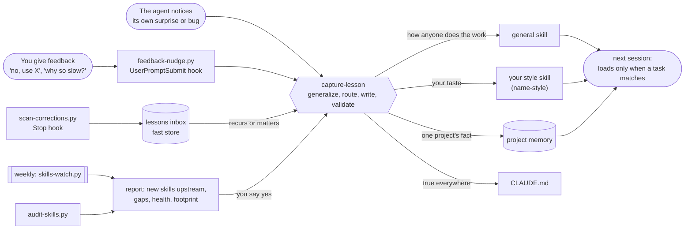

# claude-code-learns

Claude Code that keeps what you teach it. Feedback in any chat becomes a short guideline in a Skill, the library tends
itself, and a weekly check looks for new skills that fill a gap. Built only on what Claude Code already has: Skills,
hooks, memory and scheduled tasks.

**One-page explainer:** https://kat-titter.github.io/claude-code-learns/

## How it works



- **Learns fast.** A correction becomes guidance in the same turn, written for the whole family of problems rather
  than the one case. A lesson that fits an existing skill is folded into it.
- **Notices its own mistakes.** Two hooks watch for feedback, and the agent treats its own surprise and debugging as
  signals too. Each time it asks whether the lesson applies beyond this task. Once a week it audits the library.
- **Stays light.** Every session carries only skill descriptions and one memory index. In the author's setup that is
  about 11 KB of descriptions for 15 skills; the 112 KB of skill bodies and 207 KB of memory notes load only when a
  task calls for them. The weekly report tracks those numbers.

## Install

```bash
git clone https://github.com/kat-titter/claude-code-learns
```

```bash
cd claude-code-learns && ./install.sh --name yourname --dry-run
```

```bash
./install.sh --name yourname
```

It copies `capture-lesson` into `~/.claude/skills/` (or `$CLAUDE_CONFIG_DIR`), creates `yourname-style` for your
taste, a `CLAUDE.md` that routes feedback, an empty lessons inbox and an index, and merges the two hooks into
`settings.json` after backing it up. Files you already have are left alone; re-running is safe. Add `--examples` for
two worked skills, `citations` and `macos-long-render`.

**Weekly watch.** In the Claude desktop app, add a weekly scheduled task and paste
[`skills/capture-lesson/weekly-watch.md`](skills/capture-lesson/weekly-watch.md) as its prompt. It runs the watcher,
reads only what changed, and leaves at most five proposals in `~/.claude/skills-watch/<date>.md`; installing or
editing waits for your yes. Without the app, cron can run the script alone:

```bash
0 9 * * 1  python3 ~/.claude/skills/capture-lesson/scripts/skills-watch.py
```

## Where a lesson goes

| the lesson is about | it goes to | example |
|---|---|---|
| how anyone does this kind of work well | a general skill | "name each control by what was in the well" |
| your taste, voice, way of working | your `<name>-style` skill | "separate items with space, not dots" |
| one project's facts | that project's memory | "this lab ran the drug at 0.625 µM" |
| something true in every project | `CLAUDE.md` | "feedback becomes guidance, in the same turn" |

## Organizing the library

- **One home per guideline.** Before writing, find the section that already answers the question and extend its line;
  a new section is for a new sub-question, a new skill for a new question someone would ask.
- **Compress as you go.** A guideline is one line where it fits: what to do, the example, the date. A second case folds
  into the line that exists; long references and checkers sit in `references/` and `scripts/`, read only when used.
- **Refactor on signals, in one pass.** Merge skills whose descriptions fire on the same prompt; split one past ~200
  lines or answering several questions; keep a repeated guideline in its owner and link from the other; rename a skill
  whose name has drifted; archive what no task has needed. `audit-skills.py` reports each of these, repeats included.
- **Guidance, not rules.** Lines say what to do and why, so the agent can weigh them; the audit flags prohibitions to
  rephrase.
- **Cheap at any size.** Scripts read every file and hand the agent a short report (the audit takes about 40 ms on 15
  skills); state files keep each pass to what changed; only descriptions load every session.

## What's here

```
install.sh                     one command, safe to re-run, has a dry run
CLAUDE.example.md              global instructions that route feedback
settings.hooks.example.json    the two hooks, if you prefer to add them by hand
templates/my-style/SKILL.md    the personal layer, renamed to <name>-style on install
memory.example/                one fact per note, one line per note in MEMORY.md
lessons-inbox.example.md       the fast store
coding-skills.md               an example library: the author's 15 skills, one line each
skills/
  capture-lesson/              the skill that writes skills
    SKILL.md                   notice, generalize, route, write, validate, organize, watch, keep cheap, share
    weekly-watch.md            the prompt for the weekly scheduled task
    scripts/feedback-nudge.py  UserPromptSubmit hook: flags a message that reads like feedback
    scripts/scan-corrections.py  Stop hook: logs candidates to the inbox
    scripts/audit-skills.py    library health: triggers, prohibitions, misplaced taste, repeats across skills
    scripts/skills-watch.py    weekly: upstream skills, gaps, health, footprint
  citations/                   example: a skill with its own checker
  macos-long-render/           example: a skill from one surprised remark
```

The scripts find their config folder from where they are installed and the personal skill by name
(`$CLAUDE_STYLE_SKILL`, else the one `*-style` folder, else `my-style`), so nothing is hard-coded to one person.

## Why it works

It mirrors how memory consolidates: a fast store grabs what just happened, a slow pass keeps what recurs or matters,
new knowledge that fits a schema is absorbed quickly, and a quiet offline pass prunes and replays. The explainer page
maps each part to its mechanism, with references (McClelland, McNaughton & O'Reilly 1995; Kumaran, Hassabis &
McClelland 2016; Tse et al. 2007; Tononi & Cirelli 2014; Yeung & Summerfield 2012).

## Notes

- Check that a skill triggers with the official `skill-creator` plugin.
- MIT licensed; see [`LICENSE`](LICENSE).
